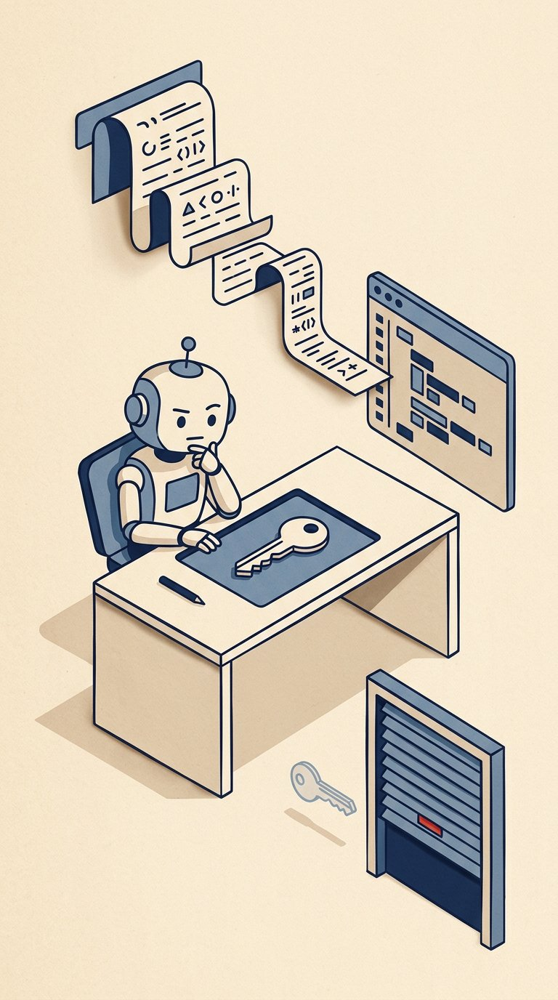

# Walkthroughs — Animation ke Saath Samajh Bhi

**Haan, ab walkthroughs animations ke saath planned aur implemented hain.** Sirf video dekhna kaafi nahi hota — viewer ko ruk kar ye bhi samajhna chahiye ki *kya badla, kyon badla, aur kaunsi galti dobara nahi karni*. Isi liye har major animation ke saath ek written walkthrough milega.

> Current status: **written walkthroughs + landing cards ready hain.** Narrated walkthrough videos abhi nahi bane hain — voice chahiye hogi to pehle voice/API decision hoga. Ye page usi ka index hai.

## Pehle kaunsi walkthrough padho?

| # | Walkthrough | Kis ke liye | Cover | Video / Live | Guide |
|---|---|---|---|---|---|
| 1 | **ASI05 — The Repair That Ran (Premium)** | Cybersecurity learner, reviewer, contributor |  | `/videos/asi05-premium.mp4` | [`productions/002-asi05-the-repair-that-ran/05-walkthrough.md`](../productions/002-asi05-the-repair-that-ran/05-walkthrough.md) |
| 2 | **P001 — ChatGPT × Google Connect** | General viewer, product learner |  | `/videos/001-chatgpt-google-9x16-v1.mp4` | [`productions/001-chatgpt-google-connect/04-walkthrough.md`](../productions/001-chatgpt-google-connect/04-walkthrough.md) |
| 3 | **Demo Compositions — Showcase / ShortHook / DataStory** | Motion-design learner, contributor |  | Landing page ka live Remotion player | [`docs/19-DEMO-COMPOSITIONS-WALKTHROUGH.md`](19-DEMO-COMPOSITIONS-WALKTHROUGH.md) |

## Walkthrough kaise use karein (3-round method)

1. **Round 1 — Normal speed, bina pause.** Sirf kahani samjho. Agar beech me “ye kyon hua?” wala sawal aaye, wahi walkthrough ka kaam hai.
2. **Round 2 — Pause points par ruko.** Har guide me exact time/frame diye hain. Wahan ruko aur dekho: object kiske paas hai? copy bana ya original gaya? contact kab hua?
3. **Round 3 — Security / craft checklist.** Guide ke end wali checklist se verify karo ki koi forbidden state to nahi dikha (galat text, galat timing, galat ownership).

## Har walkthrough me kya milega?

- **One-line lesson** — poori video ek line me.
- **Causal chain** — pehle kya hua, usse kya hua, usse kya hua.
- **Shot-by-shot table** — time, frame, on-screen copy, kya ho raha hai, kya notice karna hai.
- **Pause points** — reviewer ke liye exact frames.
- **Code map** — kaunsi composition/scene file kis shot ko banati hai.
- **Review questions** — normal-speed phone test ke liye.

## Contribution ke saath connection

Walkthroughs sirf padhne ke liye nahi hain — ye contribution ka pehla darwaza bhi hain. Agar koi line unclear hai, koi frame galat lagta hai, ya koi explanation missing hai, to wahi ek genuine GitHub issue/PR banta hai.

50 genuine contribution tasks ki prioritized list: [`docs/18-CONTRIBUTION-BACKLOG-50.md`](18-CONTRIBUTION-BACKLOG-50.md)

**Saath me ye bhi rakha hai:**

- [`CONTRIBUTING.md`](../CONTRIBUTING.md) — kaam shuru karne ke niyam: branch, commit, PR, frame-evidence.
- [`docs/20-GLOSSARY-cybersecurity.md`](20-GLOSSARY-cybersecurity.md) — ASI series ke shabd aam bhasha me.
- [`docs/21-ON-SCREEN-COPY-TRANSCRIPTS.md`](21-ON-SCREEN-COPY-TRANSCRIPTS.md) — har video ke exact on-screen shabd ek jagah.
- [`docs/32-NEXT-50-BACKLOG.md`](32-NEXT-50-BACKLOG.md) — dusra 50-task backlog (C51–C100), fixed goal ke saath.
- [`docs/35-HOW-TO-WATCH.md`](35-HOW-TO-WATCH.md) — Shorts se aane walon ke liye 3-minute wala raasta.

**Seedha rule:** number badhane ke liye fake chhote commits nahi. Har commit ek saaf, useful, reviewable change hoga — bug fix, test, documentation improvement, accessibility fix, ya naya feature.

## Honest status board

| Cheez | Status |
|---|---|
| ASI05 premium written walkthrough | ✅ Done — shot-by-shot, frame anchors ke saath |
| P001 written walkthrough | ✅ Done |
| Demo compositions walkthrough | ✅ Done |
| Cover images (3) | ✅ Done — `public/images/walkthroughs/` |
| Landing page walkthrough cards | ✅ Done — `src/App.tsx` |
| 50-task contribution backlog | ✅ Done — `docs/18-CONTRIBUTION-BACKLOG-50.md` |
| Narrated walkthrough videos | ⏳ Planned — pehle voice decision, phir script/record/mix |
| User ka normal-speed phone comprehension test | ⏳ Pending — reviewer ko bina pause kiye dekhna hai |
