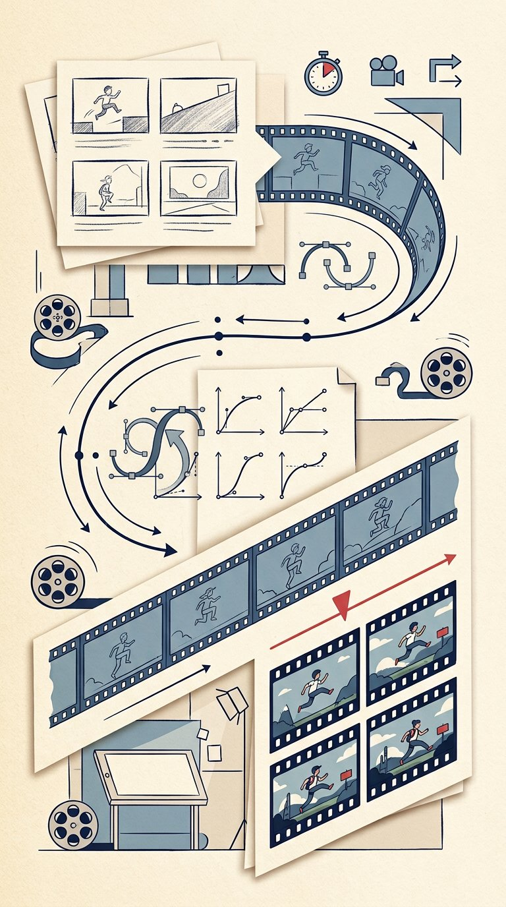

# WALKTHROUGH — Demo Compositions (Showcase · ShortHook · DataStory)

Ye teen compositions **productions nahi, prayogshala (lab) hain.** Har ek motion-design ka ek alag hunar saabit karti hai. Landing page par ye **live Remotion code** se chalte hain — video file nahi — isliye jo yahan dikhega, frame-by-frame wahi MP4 me render hoga.

Dekhne ka tareeka: landing page ke neeche wale switcher se composition chuno, play karo, scrub karo. Phir neeche ki table se milao ki har hissa *kyon* wahan hai.

---

## 1. ShowcaseKinetic — “Motion hi pehchan hai”

**Format:** 1920×1080 (16:9) · 60 FPS · 12 seconds · **Render:** `npm run render:showcase`

| Time | Kya ho raha hai | Kya seekhna hai |
|---|---|---|
| 0–3.6s | Headline masked reveal se aata hai | Bade text ko ghusana nahi, **parda uthakar** dikhana — yahi “premium” aur “cheap” ka pehla farak hai. |
| 3.6–7.2s | Teen rules ek-ek karke settle hote hain | Stagger: sab ek saath nahi aata. Aankh ko ek samay par ek hi jagah jaana hai. |
| 7.2–10s | 60 FPS count-up | Number ruk-ruk kar nahi, behta hua badhta hai. 60 FPS yahi chamakta hai. |
| 10–12s | Final hold | Khatm hone se pehle **rukna** bhi design hai. Bina hold ke dimaag register nahi karta. |

**Review sawal:** Headline aate hi “yeh professional hai” laga, ya “text ud raha hai” laga? Pehla ehsaas hi is demo ka test hai.

## 2. ShortHook — “Pehle 3 second hi zindagi hai”

**Format:** 1080×1920 (9:16) · 30 FPS · 15 seconds · **Render:** `npm run render:short`

| Time | Kya ho raha hai | Kya seekhna hai |
|---|---|---|
| 0–3s | HOOK — sabse bada daava, sabse pehle | Shorts me parichay ka samay nahi. Pehle 3 second me rukne ki wajah do. |
| 3–7s | Problem saamne aata hai | Hook ke baad dard. Bina dard ke ilaaj bekaar lagta hai. |
| 7–12s | Fix dikhta hai | Problem → fix ki continuity: jo cheez problem me thi, wahi fix me badalti hai. |
| 12–15s | Payoff + loop CTA | Aakhri hissa pehle hisse se judta hai — video dobara chale to kata hua na lage. Captions shabd-dar-shabd aate hain taaki padhne ki gati bolne ki gati se mile. |

**Review sawal:** 3 second ke andar rukne ka man hua? Agar nahi, hook kamzor hai — baaki video kitna bhi achha ho, koi dekhega hi nahi.

## 3. DataStory — “Data ko jeeta hua dikhao”

**Format:** 1080×1080 (1:1) · 30 FPS · 10 seconds · **Render:** `npm run render:data`

| Time | Kya ho raha hai | Kya seekhna hai |
|---|---|---|
| Shuruaat | Title settle hota hai | Chart se pehle sawal. Bina sawal ke data sirf number hai. |
| Beech | Bars spring se ugte hain; trend line draw-on hoti hai | Spring = wazan ka ehsaas. Line ka **banna** dikhana, bani hui line dikhane se zyada kahaani hai. |
| Ant | 128K count-up, phir hold | Sabse bada number sabse aakhir me — aur use rukne ka samay milta hai. |

**Review sawal:** Bars ugte hue “badhta hua business” mehsoos hua, ya sirf “aakde hil rahe hain”? Ehsaas hi data-film ka kaam hai.

## Teenon ko ek saath dekhne ka route (10 minute)

1. **ShowcaseKinetic** dekho — *pehchan* (brand motion kaisa lagta hai).
2. **ShortHook** dekho — *dhyaan* (pehle 3 second ka khel).
3. **DataStory** dekho — *saboot* (number ko ehsaas banana).
4. Phir koi ek production dekho (P001 ya ASI05) aur puchho: in teenon lab-hunaron me se wahan kya-kya istemal hua?

## Live preview vs final render — ek imaandaar note

Browser me live player kabhi halka sa rough lag sakta hai, kyunki wo har frame usi pal bana raha hai. **Final MP4 har frame ko Chromium se render karke banata hai** — wahi asal quality hai (buttery 30/60 FPS, koi jank nahi). Dono me frame ka *design* ek hai; farak sirf smooth-ness ka ho sakta hai.

## Files ka naksha

| File | Kaam |
|---|---|
| `src/remotion/compositions/ShowcaseKinetic.tsx` | Kinetic typography demo |
| `src/remotion/compositions/ShortHook.tsx` | 9:16 hook machine demo |
| `src/remotion/compositions/DataStory.tsx` | Chart film demo |
| `src/remotion/Root.tsx` | Saari compositions ki registry |
| `src/remotion/lib/` | Shared easing / springs / palette |
| `src/remotion/components/` | Stage, CameraRig, Captions jaise reusable tukde |

## Aage kya (backlog se)

- C26: walkthrough metadata ko typed data file me le jana — taaki nayi walkthrough add karna ek data entry ho, code surgery nahi.
- C38: har composition ke hero frames ki visual-regression checklist.
- C45: teenon demos ki combined 60s narrated walkthrough script.

Poori list: [`docs/18-CONTRIBUTION-BACKLOG-50.md`](18-CONTRIBUTION-BACKLOG-50.md) · Saari walkthroughs: [`docs/17-WALKTHROUGHS-index.md`](17-WALKTHROUGHS-index.md)
